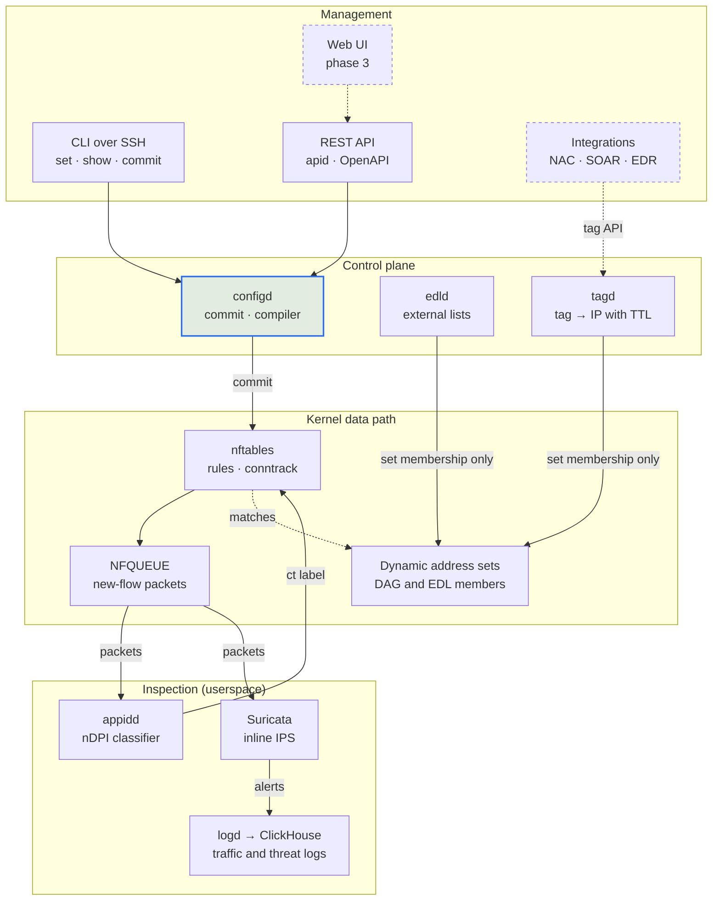
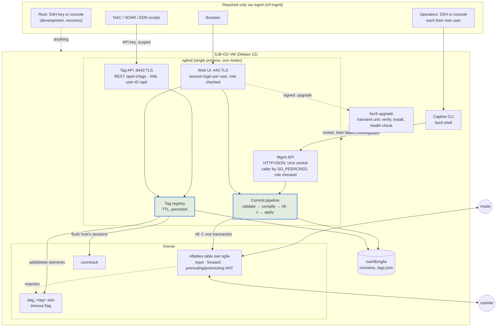
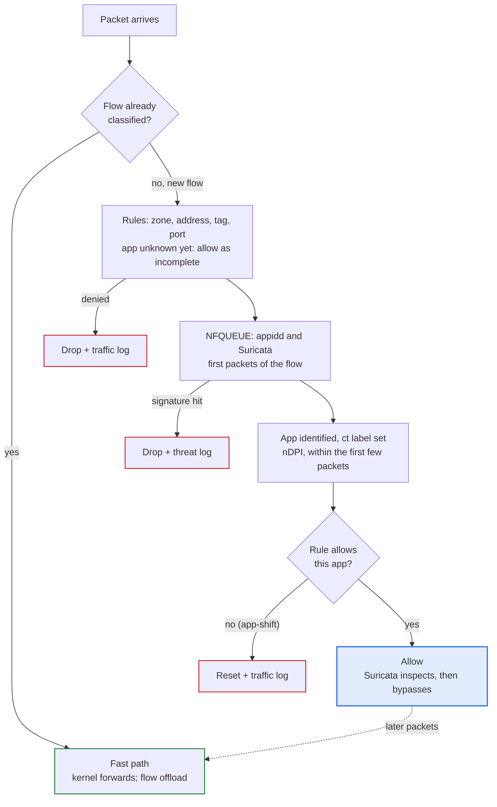
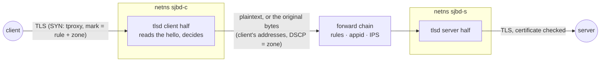
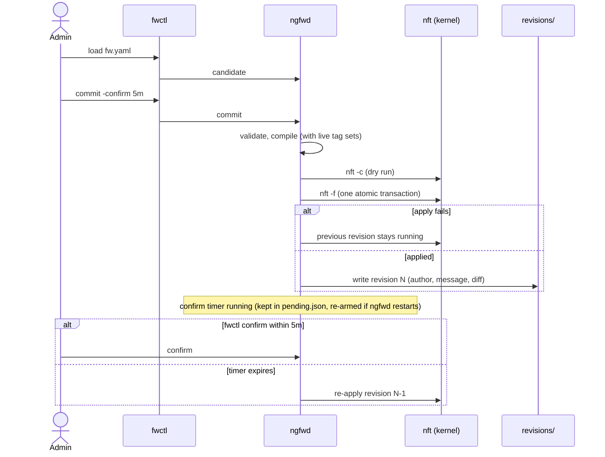
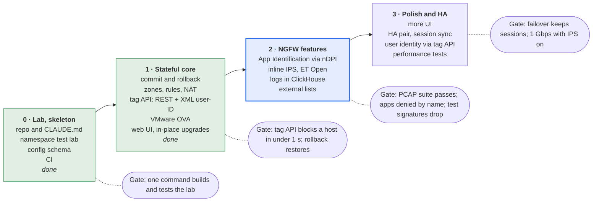

# Architecture

SJB-OS is an experiment in how far one person can get building systems
software by directing AI instead of writing code. This is its design, as
built: what each part does, how they fit, and the
build plan by phase. Diagrams are Mermaid, so GitHub renders them. Code
reviews and Claude sessions rely on it; keep it in step with the code.

Diagrams: [target architecture](#target-architecture),
[as built in phase 1](#as-built-on-the-appliance),
[packet path](#packet-path-for-a-new-flow),
[commit sequence](#commit-sequence), [roadmap](#roadmap).

## Deployment model

SJB-OS is delivered only as a VMware OVA (vSphere 8.0 U1+,
virtual hardware 20). Every design decision assumes
the appliance layout:

| Item | On the appliance |
| --- | --- |
| Interfaces | `mgmt` (unfiltered, own VRF `vrf-mgmt`), `inside`, `outside`; named at first boot from adapter order |
| Daemon | `ngfwd.service`, started before networking so the ruleset is in place before any interface is up |
| Management | Web UI (`:443`), SSH and the tag API (`:8443`), reachable only via mgmt. SSH as any SJB-OS user lands in the captive CLI (`fwctl shell`), which talks to ngfwd over a Unix socket shared with group `sjbadm`; ngfwd names the caller from the socket peer and checks their role. Root: only the SSH key and console password the operator sets at deploy time (none ship) |
| Config and state | `/etc/ngfw` (API keys, TLS, initial config), `/var/lib/ngfw` (revisions, tags) |
| First boot | `ngfw-firstboot.service`: settings from OVF properties or `guestinfo.ngfw.*`, credentials, starter policy |
| Management UI | Web UI on `https://<mgmt-ip>/` (443), served by `ngfwd`, session login per user, pages per role |
| Users and roles | Local users (`/etc/ngfw/users.json`, custom roles in `roles.json`): one password each for web, SSH and console, SSH keys, lockout; built-in superuser/admin/read-only roles and custom roles by area (view/change); `admin` permanent superuser |
| Upgrade | Signed `.upgrade` bundle applied in place (`fwctl upgrade` or the web UI); auto-restore if ngfwd is unhealthy; `fwctl upgrade rollback` (re-commits the upgrade-time config if it changed since, so the older version can read it) |

The namespace lab in `lab/` exercises the same daemon in CI. It is a test
harness, not a supported way to run the firewall. The operator guide is
[deploy/appliance/README.md](../deploy/appliance/README.md).

## Layers

| Layer | Components |
| --- | --- |
| Management | CLI over SSH, REST API (`apid`), web UI (built early, in ngfwd), external integrations |
| Control plane | `configd` (commit, compiler), `tagd`, `edld` |
| Kernel data path | nftables ruleset, conntrack with labels, NFQUEUE, dynamic address sets |
| Inspection | `appidd` (nDPI), Suricata inline, `logd` → ClickHouse |

### Target architecture

`configd` is the only writer of policy; tags and external lists change set
membership only, so they apply without a commit. Dashed boxes are phase 3 or
external.



## As built (phase 1)

The design below is the target. Phase 1 simplified it on purpose:

- `configd` and `tagd` are one daemon, `ngfwd`. One mutex serialises every
  kernel change, so a commit and a tag registration cannot interleave, and a
  commit writes live tag registrations into the new sets in the same
  transaction.
- Revisions are numbered files (`<state>/revisions/NNNNNN.yaml` + `.json`),
  not SQLite.
- The management API is HTTP/JSON on a root-only Unix socket, not gRPC.
- nftables is driven through `nft -f` transactions, not netlink.
- Tag registration flushes the host's conntrack entries, and `ngfwd` start
  flushes all of them, so existing sessions are re-evaluated.
- With no committed config, `ngfwd` applies a forward default-deny.
- The ruleset also has a fixed input chain (zoned interfaces may only ping
  the firewall) and, when configured, NAT chains: `prerouting_nat`
  (port forwards and 1:1 static NAT; the kernel translates at dstnat, and
  the decryption hand-over runs just after it at dstnat + 10, so
  everything after translation sees the server's inside address) and `postrouting` (bidirectional static NAT, then
  masquerade). `internal/natips` puts published public addresses on their
  interface (label `<dev>:nat`) so SJB-OS answers ARP for them. Hairpin NAT
  (0.9.12-r01) repeats each published entry's translation for the other
  zoned interfaces of its VRF and masquerades clients on the server's own
  network; port forwards on an interface's own address match a set ngfwd
  keeps filled with that address.
- The web UI and the tag API share the management certificate
  (`internal/mgmtcert`, `/etc/ngfw/tls.crt`), served from memory so an
  imported certificate applies to new connections without a restart.
- Packaged as a VMware OVA (see Deployment model above).
- The web UI (planned for phase 3) was pulled forward. `ngfwd` serves it on
  mgmt :443: plain HTML/JS embedded in the binary, a session-authenticated
  JSON API under `/ui/api/` that calls the same `Daemon` methods as `fwctl`,
  PBKDF2 password hashes in the user database, CSRF header on every change. Forms edit the whole
  candidate as JSON; the server stores YAML and validates on every save.
- The CLI has a configure-and-commit configuration mode (`configure`, then `set`,
  `delete`, `move`, `rename` on a working copy that is saved to the candidate
  whenever it validates) and Tab/`?` completion driven by one schema
  (`internal/cliconf`); the line editor is stdlib-only, using `stty` for raw
  mode.
- Users and roles (`internal/accounts`): users live outside the config
  (`/etc/ngfw/users.json`, `roles.json`), so a config rollback never brings
  back a deleted user or an old password. Each user is also a Unix login
  (comment "SJB-OS user", group `sjbadm`, the captive-CLI shell) that ngfwd
  creates, locks and deletes with fixed tools; SSH keys go to
  `/etc/ssh/sjb-keys/<user>`. ngfwd identifies a socket caller by
  `SO_PEERCRED` (root is a superuser, for recovery) and a web caller by the
  session, resolves their role on every request, and checks it against the
  permission every route declares (a route without one panics at start).
  Config changes are diffed section by section; each section belongs to an
  area (a test fails if a config field has none), and an edit, commit or
  rollback touching an area the role can't change is refused. Revisions
  record the verified author (`cli:alice`, `web:alice`). pam_faillock
  (sjb-migrate) locks SSH/console logins after five failures; the web UI
  keeps its own count. Built so a directory (LDAP, RADIUS, SAML, OIDC) can
  add other user sources and map its groups to these roles later.
- Captive CLI: operators have no Unix shell and no sudo. SSH
  (sshd `ForceCommand`) and the console (login shell shim) both run
  `fwctl shell`, a fixed command set over the management socket. Account
  changes that bundles can't ship as files are made by `sjb-migrate` after
  ngfwd starts and undone before a rollback.
- VRFs are Linux VRF devices (`vrf-<name>`, table 1001+), filled with VLAN
  subinterfaces (`inside.20`) that ngfwd creates and addresses at commit
  (`internal/netdev`, re-synced like routes). Static routes go into a VRF's
  table with `ip route ... vrf`, and `next_vrf` leaks a prefix into another
  VRF. The compiler gives each VRF its own conntrack zone in a raw-priority
  prerouting chain, so overlapping addresses don't collide. Zones still
  match interface names, so policy spans VRFs unchanged.
- BGP and OSPF run in FRR (bgpd, ospfd), configured natively in the SJB-OS
  config and compiled to frr.conf (`internal/frr`); commits check it with
  `vtysh -C` before anything is applied, then reload FRR (restart when the
  daemon set changes; never blocking on systemd, since ngfwd starts before
  networking). FRR arrived as Debian packages inside the upgrade bundle,
  installed in the background by `sjb-packages`. The input chain opens
  TCP 179 only from configured neighbors and OSPF only on OSPF interfaces.
- Logs, phase 1 style: no logd/ClickHouse yet. The traffic log is the
  kernel log lines the ruleset's `log prefix "ngfw <rule> <action> "`
  writes (first packet of each new connection), and the system log is
  ngfwd's own journal plus sshd and the upgrade unit; ngfwd reads both from
  the journal (`internal/logs`) for the web UI's System → Logs page and `show log`,
  and can forward them to syslog servers (see
  [Log forwarding as built](#log-forwarding-as-built-0911-r01)).
- Static routes live in the config and are part of the commit (diff,
  commit-confirmed, rollback). ngfwd installs them with `ip route replace
  ... proto 222` in the main table or the management VRF's table 100, owns
  only proto-222 routes, and re-syncs every 10 seconds because routes can't
  be added before interfaces are up and networkd may drop them. An
  uninstallable route is a commit warning, not a failure.
- In-place upgrades: signed (ed25519) bundles of the appliance overlay, built
  by `sjbpkg`, applied by `fwctl upgrade` in a transient systemd unit so it
  outlives the `ngfwd` restart. Replaced files are kept; an unhealthy `ngfwd`
  after the restart triggers an automatic restore.

### As built on the appliance

What runs in SJB-OS 0.4.0. One daemon, one lock, one nftables table.



Limits: IPv4 only; application rules skipped until phase 2; the input chain
is fixed policy, not configurable; config edited as YAML, not `set` commands.

## Components

| Component | Owns | Built on | Interface |
| --- | --- | --- | --- |
| `configd` | Candidate/running config, validation, commit, rollback, history | Go, SQLite | gRPC internally; REST via `apid` |
| Policy compiler | Config → nftables ruleset, Suricata config, App Identification map | Go, `nft -f` atomic load | Library inside `configd` |
| `tagd` | Tag → IP registrations with TTL | Go, nftables netlink, SQLite | REST `/api/v1/tags`; XML user-ID `uid-message` |
| `appidd` | Flow classification, app ID into ct label | C, nDPI, NFQUEUE | ct label out; app catalog file |
| IPS | Signature inspection | Suricata inline, ET Open | `eve.json` |
| `edld` | External dynamic lists | Go | nftables sets |
| `logd` | Traffic and threat logs | conntrack events, `eve.json`, ClickHouse | SQL; search via `apid` |
| `apid` + CLI | REST API, `set`/`show`/`commit` CLI, later web UI | Go | HTTPS + API keys; SSH |

## Packet path for a new flow

Phase 2 target. Phase 1 stops after the zone, address, tag and port rules.



1. Packet arrives. If the flow is already classified, the kernel forwards it
   (fast path, flow offload).
2. New flow: match zone, address, tag and service rules. Denied → drop and log.
   Allowed → continue as "application incomplete".
3. First packets go through NFQUEUE to `appidd` and Suricata. Signature hit →
   drop and threat log.
4. `appidd` identifies the app and sets a conntrack label.
5. Rules re-match on the app (app-shift). Not allowed → reset and log.
   Allowed → Suricata inspects to its stream depth, then bypasses; later
   packets take the fast path.

### App Identification as built (step 1: visibility)

A `chain appid` at forward priority `filter - 10` queues TCP/UDP packets
whose ct mark lacks the "classified" bit (0x1000) to NFQUEUE 0-1 with
`bypass`. `appidd` (C, nDPI 6.0) sets the app ID in ct mark bits 0-10 (bits
0-11 before 0.7.0-r01; bit 11 now asks for the session-end log) and
the done bit in the verdict (`CTA_MARK` with `CTA_MARK_MASK`, which the
kernel applies as `new = (old & ~mask) ^ mark`), so the rule bits that
logged allow rules set in bits 16-31 survive. On conntrack DESTROY it counts
bytes per app (`/run/appidd/stats.json`) and logs `ngfw-session` lines for
rule-tagged connections, which the log reader merges with the kernel's
start lines. A ct mark rather than a ct label: labels are 128 single bits,
not a field that can hold one of ~490 IDs. Steps 2 and 3 (policy on the
app, groups/categories) build on this mark.

### App Identification policy as built (step 2)

With a rule that names applications, the forward chain no longer
fast-accepts every established connection. Its head becomes: drop if
denied (bit 14); accept established connections that are final (bit 13);
accept replies; accept related ones (finalising them). Everything else goes
through the rules again, packet by packet, until the application is
settled. Allow rules jump to `chain allowed`, which finalises the connection
once appidd's done bit is set (or at once for non-TCP/UDP); allow rules
above the first application rule finalise at once, since nothing can shift
there. Application rules match `ct mark and 0x7ff` against the app IDs
(provisional answers count, so a TLS connection is YouTube from its server
name); an allow rule also passes packets while the app is unknown, so
handshakes complete. Deny rules set the denied bit, so the rest of the
connection is dropped at the head without logging again; logged allow rules
log once (bit 15). Configs without application rules compile exactly as
before.

### IPS as built (0.7.0-r01)

Suricata 7.0.10 (Debian 13's package, shipped in the bundle) runs inline on
NFQUEUE 2-3 as `sjb-ips.service`, inspecting only traffic of allow rules
that name an IPS profile. Those rules put their position + 1 in ct mark bits
16-31 (as logged rules do); `chain ips` at forward priority `filter + 10`,
after the policy decision, queues the packets of connections carrying such
a tag, with `bypass`.

Suricata never drops. Every ET Open signature is rewritten as an alert with
`nfq_set_mark` for its `signature_severity` (packet mark bits 24-27:
critical, major, minor, informational), so per-rule profiles need no
per-flow Suricata configuration. `chain ips_enforce` at `filter + 20` passes
unmarked packets, jumps by the rule tag to the profile's chain, which drops
the severities it blocks and sets the denied bit (the forward chain then
drops the rest of the connection), and clears the severity bits so NAT and
routing never see them.

ngfwd downloads ET Open (md5-checked) when a rule first uses a profile and
daily, keeps the tarball, and rebuilds the rules file when disabled
signatures change, then has Suricata reload (USR2). Suricata's EVE alerts
arrive on a unix datagram socket; ngfwd looks up the connection's ct mark
(`conntrack -G`, either direction) for the rule, application and profile,
works out the action, and writes an `ngfw-threat {json}` journal line, the
threat log. Alerts a profile ignores aren't logged.

IPS exceptions (0.9.12-r01) let one signature through for some rules,
clients or servers. They are decided in `ips_enforce` too: a signature with
exceptions marks its matches with an exception code (packet mark bits
17-23) beside its severity, every other signature sets a "plain" bit (31),
and an exception passes a packet only when its code alone is set and the
connection matches (rule tag, `ct original ip saddr`, `ct reply ip saddr`).
Anything else, two signatures with exceptions or another signature on the
same packet, goes to the profile as before. ngfwd applies the same test to
the alert for the threat log (action `alert` with the exception's name, or
nothing for `ignore`).

### TLS decryption as built (0.9.9-r04 to r06)

Outbound TLS forward-proxy decryption (optional phase 4), so App
Identification and the IPS see inside HTTPS. `tlsd` (Go, standard library
`crypto/tls`, no new dependencies) takes the connections decryption rules
cover and sends their bytes through a **cleartext loop**, so the existing
forward chain (rules, App Identification, IPS) handles them unchanged:



- **Hand-over:** chain `decrypt` (prerouting, dstnat + 10: after destination NAT) matches the decryption
  rules (zones by ingress interface and `fib daddr oifname`, addresses, TCP
  ports) on new connections and tproxies them to tlsd on port 15080, with a
  packet mark carrying the rule's position and the ingress zone's code
  (`net.ipv4.tcp_fwmark_accept` puts it on tlsd's accepted socket). Every
  hand-over line requires the `decrypt_ready` set, which ngfwd fills while
  tlsd answers on its socket and empties when it doesn't (checked every
  2 s): fail-open. QUIC for decrypted traffic is dropped there unless the
  profile allows it.
- **Cleartext loop:** tlsd opens the loop leg from namespace `sjbd-c` with
  the client's own address and port (a transparent socket) and the zone
  code in DSCP; it enters the firewall on veth `sjbd-c`, is policy-routed to
  veth `sjbd-s` through the forward hook, and is tproxied in namespace
  `sjbd-s` to tlsd's server half. Raw prerouting puts the loop interfaces in
  conntrack zone 0xfff0, apart from the client's original connection with
  the same tuple. Every security rule gets a loop form of its zone match
  (`iifname "sjbd-c" ip dscp <zone codes>`, `oifname "sjbd-s" fib daddr
  oifname <egress interfaces>`), so the rules apply as written; a denied
  loop connection makes tlsd reset the client. TCP early demux is off while
  decryption runs (it would hand loop packets to tlsd's own client socket).
  `sjb-decrypt-net.service` builds the loop before `sjb-tlsd.service`
  starts (tlsd's sandbox is a private mount namespace, which must already
  see the loop's namespaces) and removes it when tlsd stops.
- **Decisions:** excluded names (built-in list plus the config's), learned
  pinned servers, connections that can't be decrypted and observe mode pass
  through; the rest are decrypted: tlsd connects to the server (ALPN as the
  client offered), checks its chain against Debian's roots, and completes
  the client's handshake with a week-long leaf from the decryption CA (or
  from the untrusted CA when the server's failed), shared leaf key in
  memory, cached per name. A client that rejects it is learned for 24 h.
  Each decision is an `ngfw-decrypt {json}` journal line (no content).
- **CA:** `/etc/ngfw/decryption` (never in bundles or revisions): ca.crt/key
  and untrusted.crt/key, keys 0600 owned by `sjb-tls`, the account tlsd runs
  as with only CAP_NET_ADMIN and CAP_SYS_ADMIN (setns). `/etc/ngfw` stays root-only:
  the unit bind-mounts just the CA folder, read-only, at `/run/sjb-tlsd-ca`. ngfwd generates or
  imports it and serves only the certificate.
- **Policy:** ngfwd writes `/var/lib/sjb-os/tlsd-policy.json` (rules with
  their resolved profiles, exclusions, mode) at each commit and has tlsd
  reload it; `system decryption observe` sets observe mode (0.9.9-r04
  observed only; r05 decrypts).
- **Inspectability:** when the client offers HTTP/1.1, tlsd offers only that
  to the server (and so to the client): App Identification names the
  application from the plaintext Host header, and Suricata's HTTP parser
  sees whole requests. h2-only clients keep HTTP/2. Server sessions are
  resumed from a 4096-entry cache.
- **Load:** at 4096 connections (`-max-conns`) tlsd reports itself busy;
  ngfwd empties `decrypt_ready` until it has room, so overload fails open
  rather than exhausting memory. An imported subordinate CA's
  intermediates (`chain.crt`) follow it in every issued chain.
  `tools/decrypt-perf.sh` measures throughput in the namespace lab.
- Limits: default VRF only, outbound only, IPv4, no revocation checking;
  upstream connections come from the firewall's own address.

### Log forwarding as built (0.9.11-r01)

`internal/logfwd`, inside ngfwd. One journal follower (`journalctl -f -o
json`, matched to the kernel transport and the log units: appidd, tlsd,
ngfwd, sshd, the upgrade and first-boot units, Kea) turns each record into
a log entry with the same parsers the Logs views use
(`logs.Journal.ParseRecord`: kernel `ngfw <rule> <action>` lines and
appidd's `ngfw-session` lines are traffic, `ngfw-threat` threats,
`ngfw-decrypt` decryption, the rest of those units system). Each entry is
formatted per server (RFC 5424 header, JSON or CEF body) and put on that
server's queue: 10,000 messages, oldest dropped and counted when full.
A sender per server dials (UDP, TCP or TLS with `crypto/tls`, octet-counted
on streams), bound to `vrf-mgmt` with `SO_BINDTODEVICE` unless the server is
in the default VRF, writes the queue, and reconnects with backoff (1 s to
30 s), putting back the message whose write failed.

- **Config:** `log_servers` (area `logging`), applied after each commit
  like FRR and Kea: `syncLogFwdLocked` hands the running list to the
  forwarder, which keeps unchanged servers' connections, restarts changed
  ones, and runs the follower only while there is a server. Problems are
  status (`show log-forwarding`, the Log forwarding page), never commit
  failures.
- **Position:** the follower saves the journal cursor to
  `/var/lib/ngfw/logfwd.cursor` every second and when it stops, and starts
  with `--after-cursor` (or, the first time, `-n 0`: from now on), so a
  restart repeats at most a second and loses nothing; a cursor the journal
  no longer has means carrying on from now.
- **Start order:** ngfwd configures the forwarder only after its start-up
  conntrack flush. A TCP connection opened before it would lose its entry
  mid-handshake, and the input chain drops the server's reply to a
  connection conntrack doesn't know. Established streams survive later
  flushes (a policy commit): conntrack picks them up again from the
  firewall's next packet.
- `lab/gate-logfwd.sh` replays journal records through
  `lab/fake-journalctl.py` (the lab has no journal) into UDP, TCP and TLS
  sinks; the boot test sends to a sink on the test host through mgmt.

### Monitoring as built (0.9.13-r01)

`internal/metrics` holds one snapshot type. `Daemon.Metrics()` assembles
it from what ngfwd already reads:
- `/sys/class/net` and `/proc` (interfaces, sessions, CPU, memory, disk);
- nft counters (rules, by their `rule:` comments, summed across lines;
  the default deny; NAT, as in `show nat`);
- the IPS, decryption, App Identification and log forwarding status
  methods, and the tag registry;
- IPS matches counted in `IPSAlert`;
- the last commit's outcome, recorded by Commit, Rollback and
  auto-rollback.

The parts behind d.mu (IPS, NAT, decryption, Status) are read in a
goroutine that the snapshot waits on for at most 3 s, reusing the last
values when a commit holds the lock. The SNMP agent would otherwise see a
stale snapshot and report ngfwd down.

- **Prometheus:** `GET /metrics` on the tag API listener (TLS, the
  management certificate), keys with scope `metrics:read`. The text format
  is written by hand (no client library), each family's samples together.
- **SNMP:** net-snmp's snmpd (v3 USM, v2c with source restrictions, the
  standard MIBs), shipped in bundles like FRR. `internal/snmp` compiles
  `snmp`, `snmp_trap_receivers` and the credentials file into
  `/etc/snmp/snmpd.conf`. `syncSNMPLocked` applies it after commits and
  every 10 s (restart when it changed, stop and remove when SNMP is off).
  A unit drop-in runs snmpd in `vrf-mgmt` with the DISMAN trigger modules
  on, and strips stored `usmUser` lines at each start.
- **SJB-OS-MIB:** `pass_persist` to `fwctl snmp-pass`, which reads
  `/run/sjb-os/metrics.json` (saved every 15 s while SNMP is on, group
  Debian-snmp). It needs no access to ngfwd's socket. A snapshot older
  than 60 s turns the service table into "ngfwd down".
- **Traps:** IF-MIB link up/down, plus `monitor` triggers on SJB-OS-MIB
  (a service needed and down, the IPS engine down, the last commit
  failed). They are sent by snmpd's internal queries (user `sjb-internal`,
  authNoPriv) to the receivers as v2c traps or v3 traps/informs.

### Backup and restore as built (0.9.11-r01)

`internal/backup` makes one armoured text file (so the captive CLI can
take it by paste): `-----BEGIN SJB-OS BACKUP-----`, base64 of
`{header, payload}`. The header (format version, SJB-OS version, author,
hostname, running revision, contents, SHA-256 of the payload) is readable
without the passphrase; the payload holds the running config's YAML and,
for superusers, an `accounts.Snapshot` (users with role, state, SSH keys,
web hash and shadow hash; custom roles), the API key file and (from
0.9.13-r01) the SNMP credentials.
Accounts mean encryption: AES-256-GCM with a PBKDF2-SHA256 key (600,000
iterations), the header as additional data, so neither part can be
changed unnoticed.

- **Config restore** is `SetCandidateAs`: the edit's own checks (parses,
  validates, every changed area allowed for the caller). Nothing is applied
  until a commit; the UI's restore offers a commit with a 10-minute confirm.
  `/etc/ngfw` is never written by a config restore.
- **Accounts restore** (superusers) is `accounts.Store.Restore`: checked
  in full first, then roles merged by name and users added or updated
  through the Unix side (`useradd`/`usermod` via `Ensure`, `chpasswd -e`
  for the shadow hash, the key file); never deletes, never touches `admin`
  or the caller. The API key file is replaced atomically and the tag API
  switches to the new keys at once (an atomic pointer). Like every account
  change, it is outside the config revisions.

## Commit sequence

As built in phase 1 (Suricata and `appidd` reloads arrive in phase 2):



1. Edits land in the candidate config.
2. Validate: schema plus semantic checks (unknown references, shadowed rules).
3. Compile to a bundle: nftables ruleset, Suricata rule selection, App Identification map.
4. Record the revision (and, for commit-confirmed, its rollback target and
   deadline), then apply the nftables ruleset in one atomic `nft -f`
   transaction, then make the revision running. A failure at any of these
   steps undoes the earlier ones and leaves the previous policy in force; if
   restoring the previous ruleset fails too, the daemon reports a recovery
   state (Status, `show status`, the web UI) instead of claiming success.
5. If the compiled policy changed, flush conntrack so every existing
   connection is re-evaluated against it (its ct mark holds the old rule
   positions, IPS tag and classification bits).
6. Routing (FRR), DHCP (Kea), the IPS engine, interface addresses and VLANs
   converge after the commit, asynchronously: failures are warnings and
   periodic retries, not rollbacks. Only the nftables step is atomic.
   `rollback N` re-commits N through the same steps.

Tag registrations and EDL updates change set membership only, never the
ruleset, so they apply in milliseconds without a commit.

## Example compilation

A rule "zone users → internet, source DAG quarantine, app bittorrent, deny"
compiles to roughly:

```
set dag_quarantine { type ipv4_addr; flags timeout; }
chain fwd_users_internet {
  ip saddr @dag_quarantine ct label app_bittorrent drop
}
```

## Roadmap

Phases 0 and 1 are done (in days rather than the planned six weeks; see
[effort-log.md](effort-log.md)), and the web UI and in-place upgrades were
pulled forward from phase 3. Each phase ends at a gate test, not a feature
list.



Optional phase 4, open-ended: TLS forward-proxy decryption (0.9.9-r04
to r06: see [TLS decryption as built](#tls-decryption-as-built-099-r04-to-r06))
and custom App Identification signatures.
